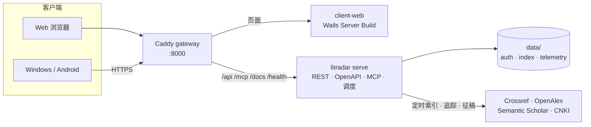

<div align="center"><h1>LitRadar</h1>
面向学术期刊的自托管检索与订阅平台：汇聚 Crossref、OpenAlex、Semantic Scholar 与 CNKI 元数据，构建本地全文索引，提供检索、收藏、每周更新、文献追踪与征稿追踪。
<p><br><a href="https://github.com/QianFuv/LitRadar/actions/workflows/ci.yaml"></a> <a href="https://github.com/QianFuv/LitRadar/releases/latest"></a> <a href="docs/operations/docker.md"></a> <a href="LICENSE"></a></p>
<p><a href="#快速开始"><b>快速开始</b></a> · <a href="docs/README.md"><b>文档中心</b></a> · <a href="docs/guides/clients.md"><b>客户端</b></a> · <a href="docs/reference/api.md"><b>API 与 MCP</b></a> · <a href="https://github.com/QianFuv/LitRadar/releases"><b>下载</b></a></p>
</div>

<br>

## 为什么是 LitRadar

|                                                                                                                                       |                                                                                                    |
| ------------------------------------------------------------------------------------------------------------------------------------- | -------------------------------------------------------------------------------------------------- |
| **多源索引**<br>英文期刊由 Crossref、Semantic Scholar 与 OpenAlex 组成 Scholarly 流程，中文期刊走 CNKI 流程，统一到一份规范期刊目录。 | **本地检索**<br>SQLite FTS5 全文索引，Go 侧完成中文切词与大小写/重音折叠，检索不依赖任何在线服务。 |
| **文献追踪**<br>用 OpenAI 兼容模型从新增文章中挑选与研究方向相关的论文，推送到 PushPlus 或写入追踪文件夹。                            | **征稿追踪**<br>汇总期刊征稿信息，保存原文证据，按来源刷新。                                       |
| **个人工作区**<br>账号、邀请码、访问令牌、收藏夹、关系图谱与引用导出；支持 OIDC 单点登录。                                            | **开放接入**<br>REST API、由 Go 类型生成的 OpenAPI 文档，以及 Streamable HTTP MCP。                |

## 工作方式



三个容器各司其职：Caddy 网关是唯一对外端口，同源转发页面与接口；`client-web` 只提供前端页面，不接触数据和密钥；`litradar serve` 持有全部数据、部署密钥和内嵌调度。Web、Windows 与 Android 共用同一套 Vite 前端。详见[系统架构](docs/architecture/README.md)。

## 快速开始

以下步骤在仓库根目录的 **Bash** 中执行（Windows 请用 WSL），需要 Docker Compose、OpenSSL 和 curl。已有数据的升级或 HTTPS 接入见 [Docker 部署](docs/operations/docker.md)。

**1. 准备数据目录和部署密钥。** 仅在尚无密钥时生成；已有数据库必须继续使用与之匹配的密钥。

```bash
mkdir -p data secrets
if [ ! -e secrets/litradar.key ]; then
  (umask 077; openssl rand -out secrets/litradar.key 32)
fi
```

Linux 原生 Docker Engine 还需让容器账号 `10001:10001` 读写数据目录、读取密钥（Docker Desktop 通常无需此步）：

```bash
sudo chown -R 10001:10001 data
sudo chown 10001:10001 secrets/litradar.key
sudo chmod 600 secrets/litradar.key
```

密钥必须恰好为 32 个原始字节，与数据库备份分开保管，见[安全说明](docs/operations/security.md)。

**2. 启动服务。**

```bash
docker compose pull
docker compose up -d --remove-orphans
docker compose ps
```

网关默认只在 `127.0.0.1:8000` 发布端口。镜像自带官方期刊目录，首次运行会准备 `data/meta/`，升级时保留自定义文件。

**3. 创建首个管理员。** 公开注册不能创建首个管理员；密码经 stdin 传入，不进入参数或命令历史，至少 12 个 Unicode 字符；命令只在用户表为空时成功。

```bash
IFS= read -r -s -p 'Admin password: ' ADMIN_PASSWORD
printf '\n'
printf '%s\n' "$ADMIN_PASSWORD" |
  docker compose run --rm -T server admin bootstrap \
    --username admin \
    --password-stdin
unset ADMIN_PASSWORD
```

**4. 建立索引。** CNKI 元数据索引无需 API key，可直接运行：

```bash
docker compose run --rm server index \
  --secret-key-file /run/secrets/litradar_key \
  --file chinese_journals.csv \
  --update
```

索引 `english_journals.csv` 或 `ccf_computer_journals.csv` 前，先在管理后台的运行配置中填写 Crossref 联系邮箱以及 OpenAlex、Semantic Scholar API key。验证码、断点恢复和并发参数见 [CLI 参考](docs/reference/cli.md)与 [CNKI 数据源](docs/reference/sources/cnki.md)。

**5. 验证并访问。**

```bash
curl --fail http://localhost:8000/health/ready
curl --fail --output /dev/null http://localhost:8000/
```

打开 `http://localhost:8000/` 登录，选择已索引的数据库并检索一篇已知文章。接口位于 `/api`，API 文档位于 `/docs`，OpenAPI 位于 `/openapi.json`，MCP 位于 `/mcp`（需要会话或访问令牌）。

## 客户端

| 平台    | 发布形式                                    | 说明                                                 |
| ------- | ------------------------------------------- | ---------------------------------------------------- |
| Web     | `litradar-client-web` 容器镜像与 Linux 归档 | 随 Docker Compose 部署，与接口同源                   |
| Windows | x64 便携版 zip（未签名）                    | 数据保存在 exe 同目录，令牌保存在 Windows 凭据管理器 |
| Android | arm64-v8a APK                               | 仅发布签名构建；Wails 移动端支持为实验性             |

原生客户端首次启动时填写服务端 HTTPS 地址，用账号密码或 OIDC 登录。不发布 iOS、macOS 或 Linux 桌面客户端。详见[客户端与登录](docs/guides/clients.md)。

## 本地开发

需要 Go、Node.js 和 pnpm，固定版本见[开发指南](docs/guides/development.md#工具链)。安装依赖后，在仓库根目录一条命令同时启动 Vite（8000）与 Go 服务端（8001）：

```bash
pnpm install --frozen-lockfile
pnpm dev
```

测试分层与统一命令见[测试系统](docs/guides/testing.md)，前端结构见[前端包说明](apps/client/frontend/README.md)。

## 版本发布

修改根目录 `VERSION`（如 `0.6.0` → `0.6.1`），运行 `pnpm generate:api` 更新 OpenAPI 基线，一并提交并推送到 `main`。CI 全部检查通过后自动创建 GitHub Release，并发布 `litradar-server` 与 `litradar-client-web` 镜像，无需手动打标签。详见[版本发布](docs/operations/releases.md)。

## 文档

| 你想要…    | 从这里开始                                                                                                                                                            |
| ---------- | --------------------------------------------------------------------------------------------------------------------------------------------------------------------- |
| 部署与运维 | [Docker 部署](docs/operations/docker.md) · [备份与恢复](docs/operations/backup.md) · [日志运维](docs/operations/logging.md) · [安全说明](docs/operations/security.md) |
| 使用与接入 | [通知与追踪](docs/guides/notifications.md) · [API 参考](docs/reference/api.md) · [CLI 参考](docs/reference/cli.md)                                                    |
| 参与开发   | [系统架构](docs/architecture/README.md) · [开发指南](docs/guides/development.md) · [测试系统](docs/guides/testing.md)                                                 |

全部文档见[文档中心](docs/README.md)。

## 许可证

[MIT License](LICENSE)
